# 27 Transformer 注意力究竟在做什么

> 这集把三种注意力拆开：编码器看输入，解码器看已经生成的前缀，两边再对照一次。
> 笔记按讲解顺序写，板书和公式截在对应的话旁边。
> 来源：https://www.douyin.com/video/7674249675532143915 · 34 分钟 · 本集 27/35

## 讲解导览

1. 【00:00】三种注意力在 Transformer 中的分工
2. 【02:00】Attention 让 token 获得上下文
3. 【04:01】Seq2Seq 注意力与 Transformer 的对应
4. 【06:03】三种注意力的 Q/K/V 来源
5. 【08:03】Self-Attention 的输入表示
6. 【10:05】线性投影得到 Q、K、V
7. 【12:06】Query、Key 与 Value 的直觉
8. 【14:06】逐位置计算匹配分数
9. 【16:07】Softmax 形成注意力权重
10. 【18:07】加权求和得到新上下文
11. 【20:08】多头注意力组合多个视角
12. 【22:09】Decoder 因果掩码
13. 【24:10】Cross-Attention 查询源序列
14. 【26:12】编码一次、逐步生成输出
15. 【28:12】推理过程中的 KV Cache
16. 【30:12】Q 不缓存与稳定前缀
17. 【32:12】总结注意力与下集预告

---

## 1. 三种注意力在 Transformer 中的分工

Transformer 常见三种注意力：Encoder 的 self-attention、Decoder 的 masked self-attention 和 Encoder–Decoder cross-attention。它们反复出现，是因为 Encoder 要建模输入内部关系，Decoder 要建模已生成前缀，还要从源输入读取信息。

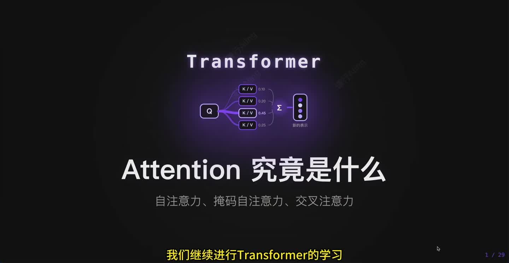
*图1：编码器、解码器、两者之间，三种注意力各管一段*

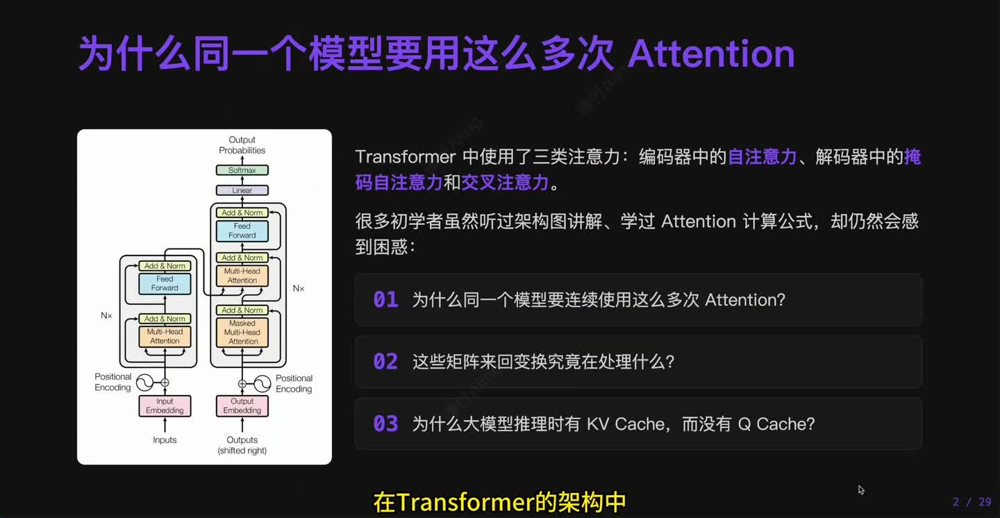
*图2：三种注意力在整张结构图上的位置*

## 2. Attention 让 token 获得上下文

Attention 为每个 token 生成新的上下文表示。比如 “Animal didn’t cross the street because it was too wide” 中 it 的理解依赖上下文；新表示可融合序列中相关位置的信息，而不仅是 token 自身嵌入。

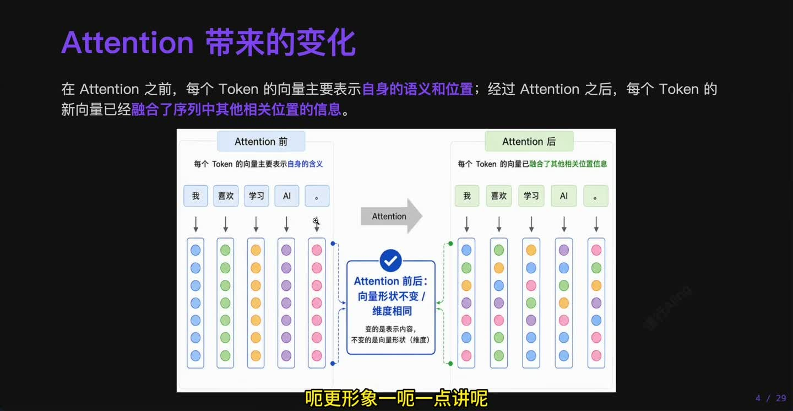
*图3：it 指代太宽的路还是太累的动物，要看上下文*

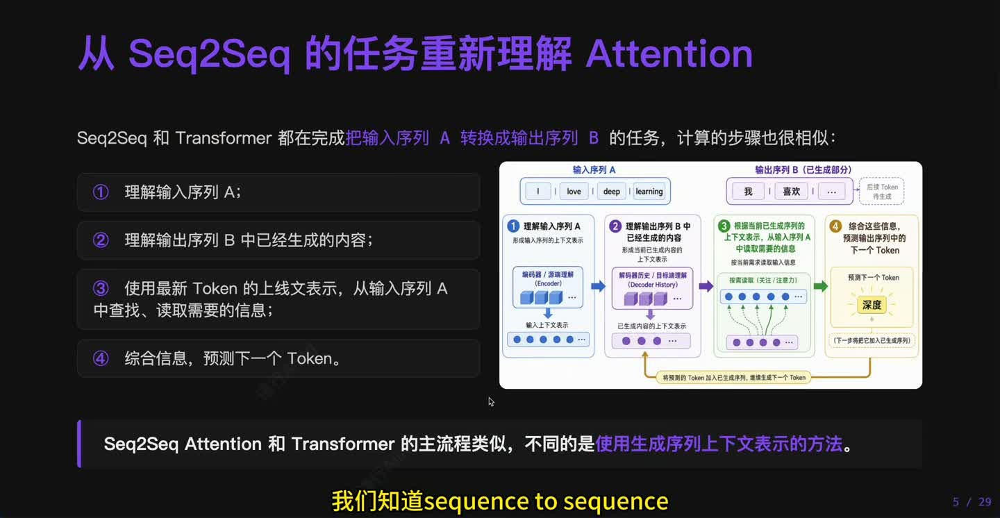
*图4：同一个 token，融进上下文之后表示变了*

## 3. Seq2Seq 注意力与 Transformer 的对应

在 RNN Seq2Seq 中，Decoder 的当前状态可作为 Query，Encoder 每步隐藏态作为 Key/Value；通过注意力读源信息。Transformer 保留按需读取的思路，同时以 self-attention 处理序列本身，不再靠 RNN 逐步生成全部隐藏态。

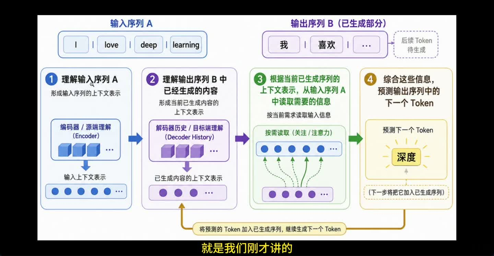
*图5：旧的 Seq2Seq，解码器用当前状态去读编码器*

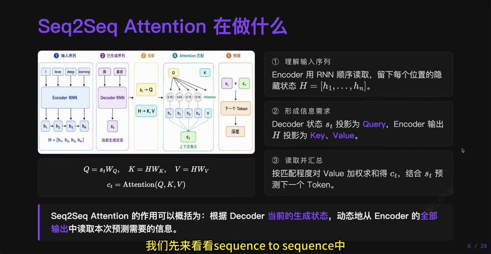
*图6：Transformer 仍按需去读，序列本身改由自注意力处理*

## 4. 三种注意力的 Q/K/V 来源

Encoder 自注意力的 Q、K、V 都由输入序列构造；Decoder masked self-attention 的三者来自目标前缀，并对未来位置遮罩；cross-attention 则用 Decoder 的表示作为 Q，Encoder 输出作为 K、V。运算范式相近，输入来源和可见范围不同。

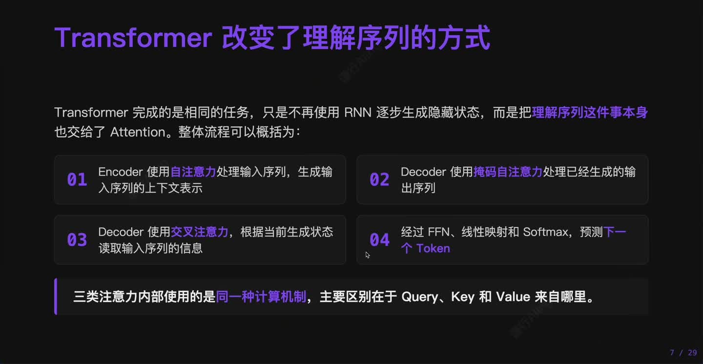
*图7：编码器的 Q、K、V 都来自输入*

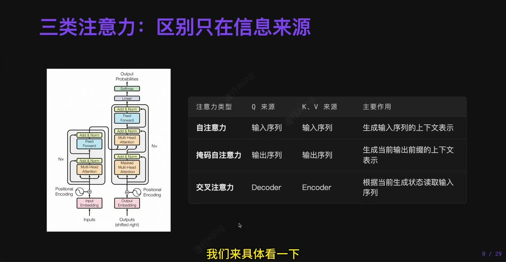
*图8：交叉注意力的 Q 来自解码器，K 和 V 来自编码器*

## 5. Self-Attention 的输入表示

经过 Embedding 与位置表示后，输入可写成矩阵 $X\in\mathbb{R}^{T\times d_{model}}$，每一行对应一个 token。Attention 输出同样是一行一个 token 的表示，但每行会按权重汇入其他相关位置的信息。

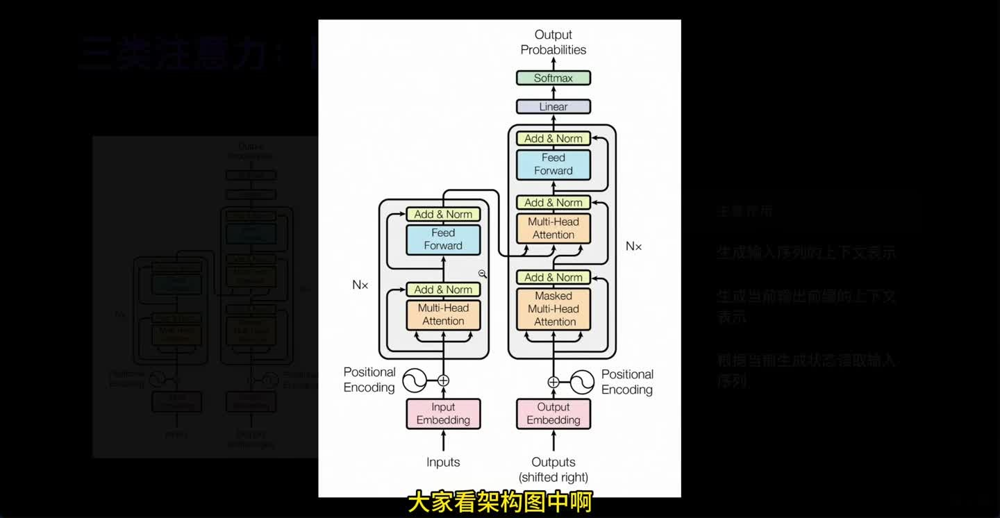
*图9：输入矩阵每一行是一个 token*

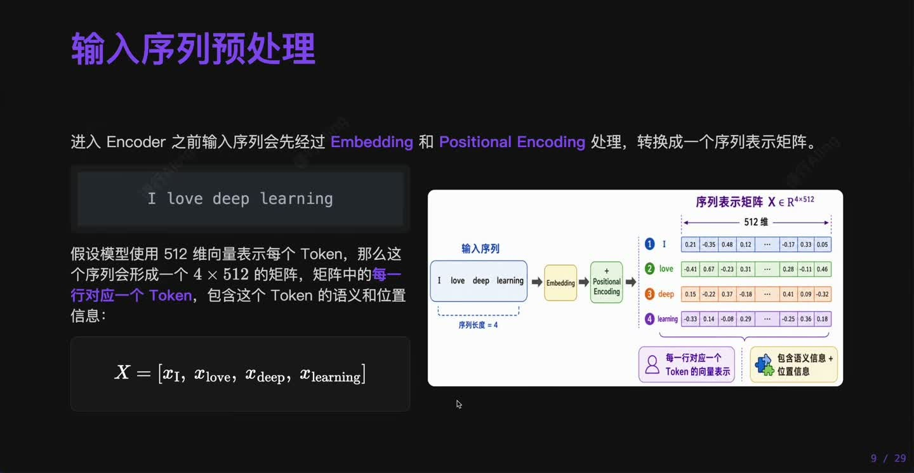
*图10：输出仍是一行一个 token，行里混入了别的位置*

## 6. 线性投影得到 Q、K、V

模型用三组可学习矩阵把输入投影到不同表示空间：$Q=XW_Q$、$K=XW_K$、$V=XW_V$。Q、K、V 不是人工指定的语言学特征，而是随训练目标共同学习的向量。

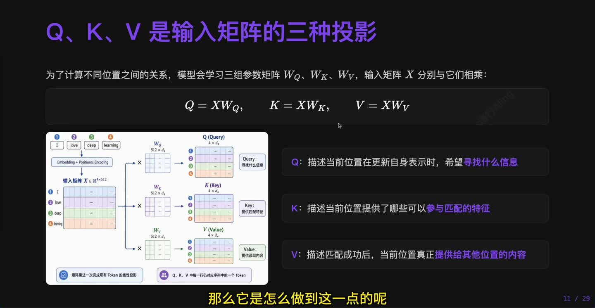
*图11：三组矩阵把输入投影成 Q、K、V*

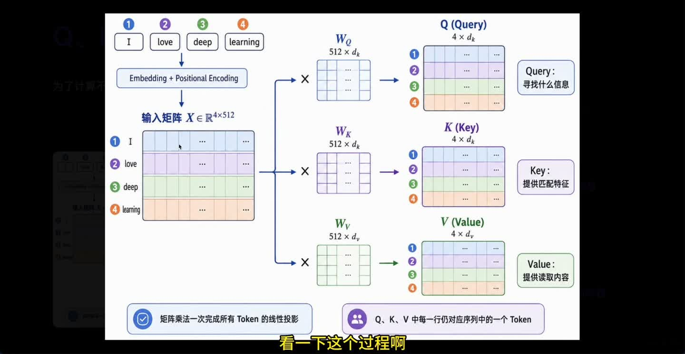
*图12：Q、K、V 是训练出来的，不是人手写的特征*

## 7. Query、Key 与 Value 的直觉

可以把 Q 想成当前位置“要找什么”，K 想成各候选位置“能提供什么匹配线索”，V 则是匹配后真正汇总的内容。论文/代码里它们全是向量矩阵；这个类比帮助理解功能，但不代表每个维度都有可读的人类语义。

查资料的比喻可以帮助记 Q、K、V：Query 是当前要找什么，Key 用来判断每条信息和问题有多匹配，Value 是匹配后真正取回的内容。Attention 先用 Q 和 K 算权重，再用权重混合 V；这三个角色在不同注意力模块里来自不同序列。

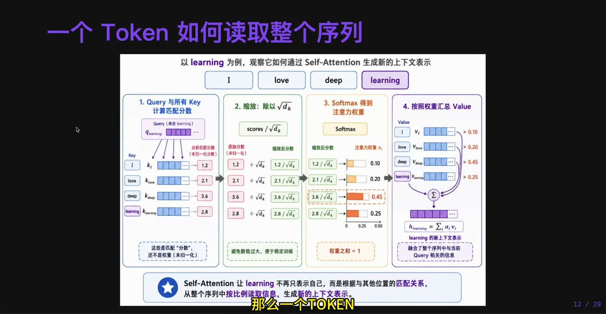
*图13：Q 是要找什么，K 是匹配线索，V 是取回的内容*

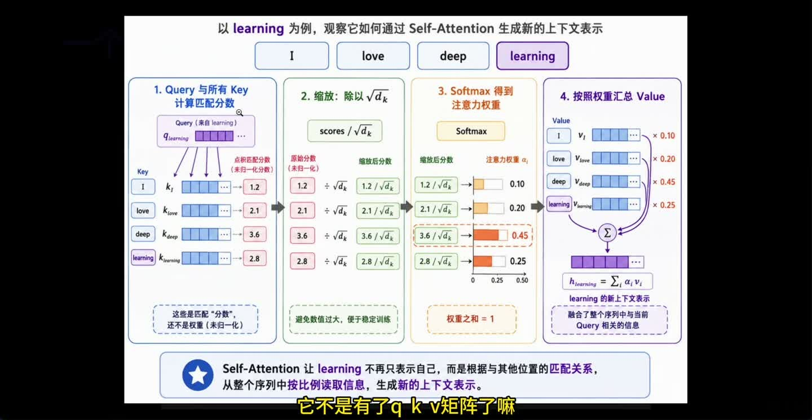
*图14：先用 Q 和 K 算权重，再用权重混合 V*

## 8. 逐位置计算匹配分数

对每个 Query 与各 Key 计算点积，形成匹配分数。单个位置可写作 $q_i k_j^T$；所有位置可一次矩阵计算为 $QK^T$。分数越高，该位置后续通常获得越大的注意力权重。

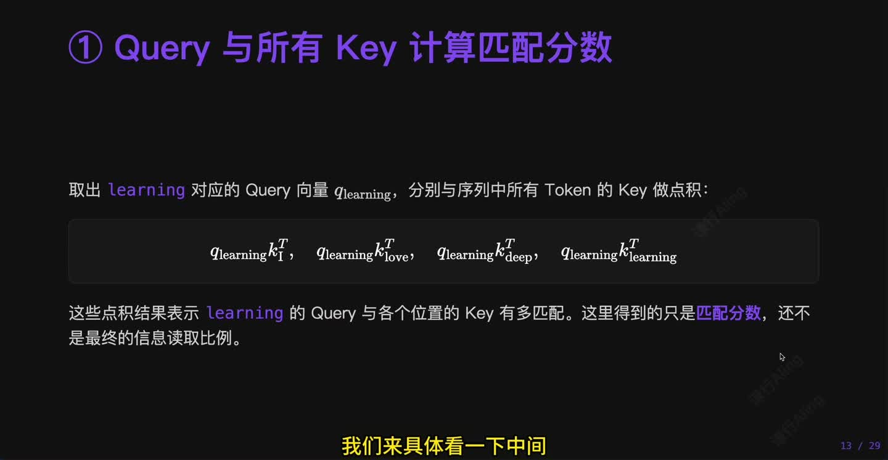
*图15：每个 Query 和各个 Key 做点积*

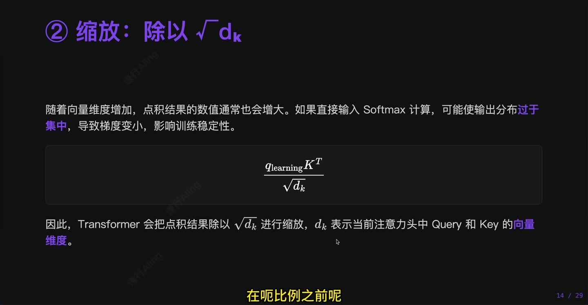
*图16：全部位置一次写成 QKᵀ*

## 9. Softmax 形成注意力权重

常见 scaled dot-product 形式先算 $QK^T/\sqrt{d_k}$，再沿 Key 位置做 Softmax 得到权重。因果 mask 会在归一化前将不可见的未来位置设为负无穷，使其 Softmax 权重为零。

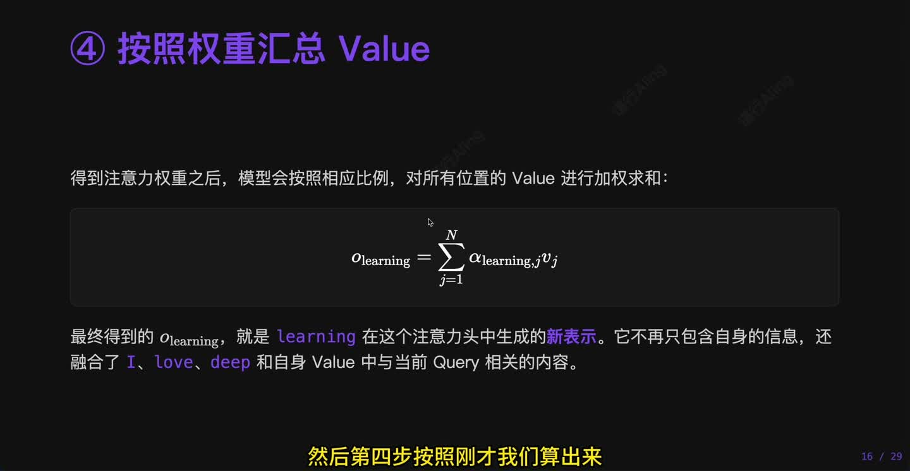
*图17：分数先除以 √dₖ，再做 Softmax*

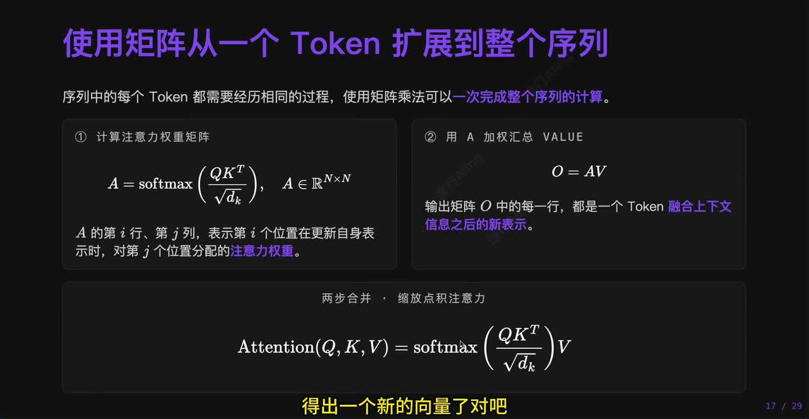
*图18：因果掩码把未来位置压成 0*

## 10. 加权求和得到新上下文

对每个 Query，将权重作用到 Value 并求和：$\mathrm{Attention}(Q,K,V)=\mathrm{softmax}(QK^T/\sqrt{d_k})V$。每个 token 得到一个新的上下文向量，作为后续层的输入。

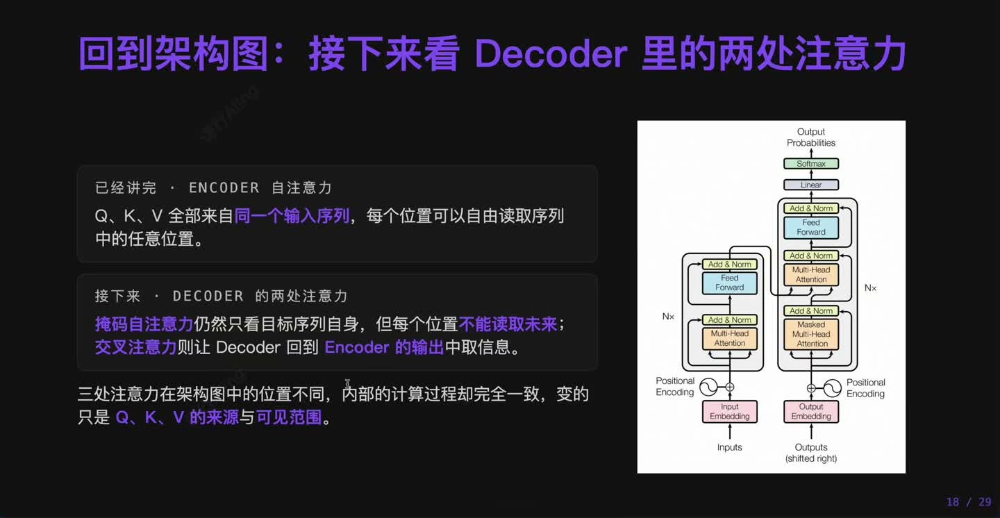
*图19：权重乘上 V，得到新的上下文向量*

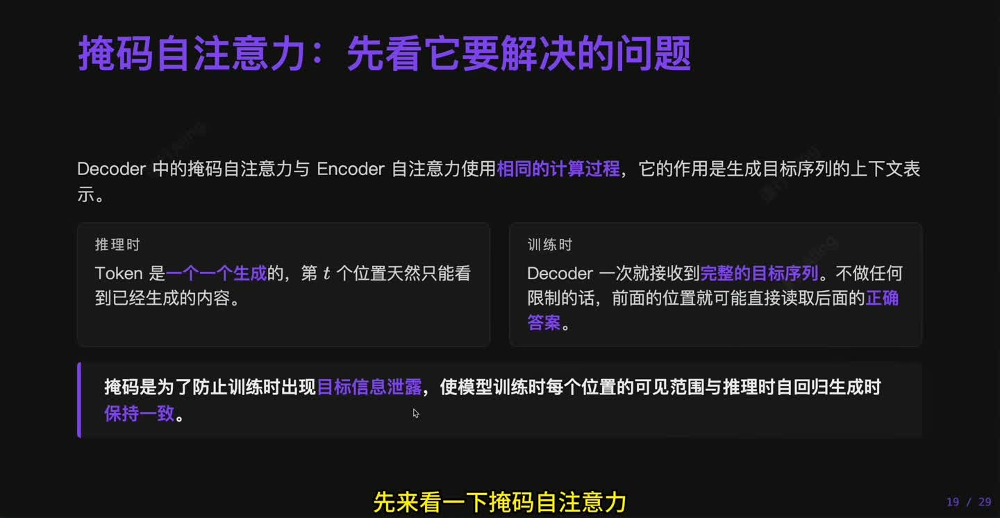
*图20：每个 token 拿这个新向量进入下一层*

## 11. 多头注意力组合多个视角

Multi-Head Attention 将输入投影到多个子空间，各 head 平行执行注意力，再拼接并线性融合。不同头有机会学习不同关联模式；并不能保证每个头都对应一个可清晰命名的语义功能。

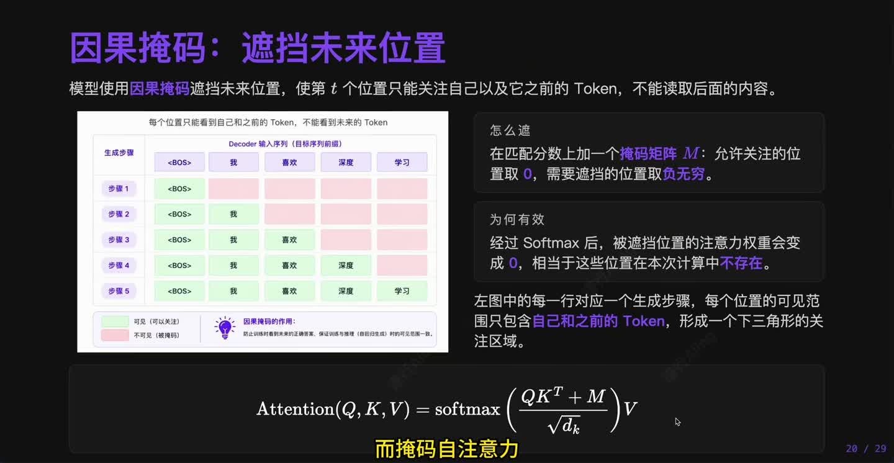
*图21：多个头各看一个子空间*

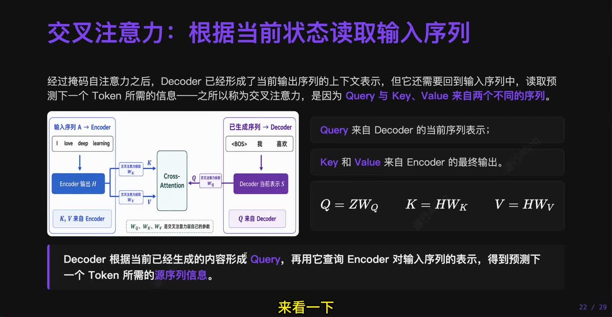
*图22：各头拼起来，再做一次线性融合*

## 12. Decoder 因果掩码

Decoder 的 teacher forcing 训练一次会提供整段目标序列，但位置 $t$ 只能依赖不晚于 $t$ 的 token。因果掩码屏蔽未来位置，防止训练目标泄漏。训练时仍可并行计算全部位置，因为 mask 保证每个位置只能读取允许的前缀。

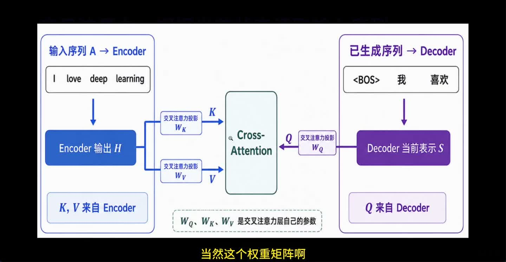
*图23：位置 t 只能看不晚于 t 的 token*

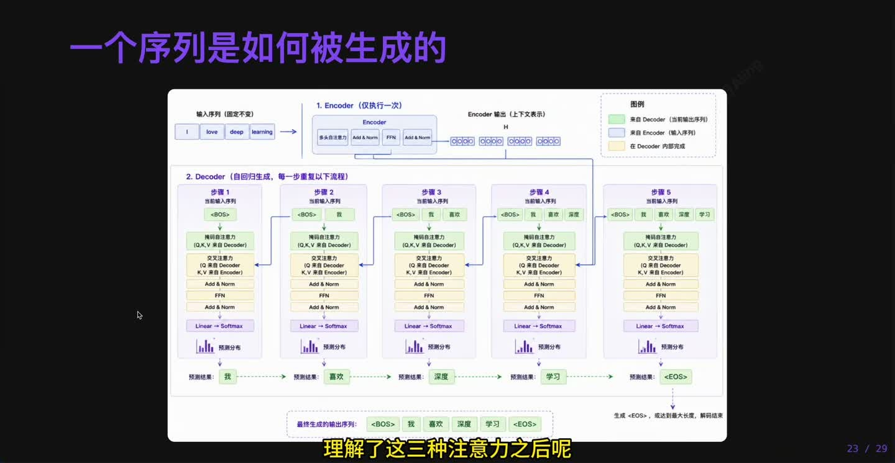
*图24：掩码挡住未来，训练仍可以并行*

## 13. Cross-Attention 查询源序列

Cross-attention 让 Decoder 当前目标表示产生 Q，并与 Encoder 各源位置的 K 匹配，再按权重汇总 Encoder 的 V。这样生成“深度”或“学习”等目标 token 时，Decoder 可从源句相应位置取信息。

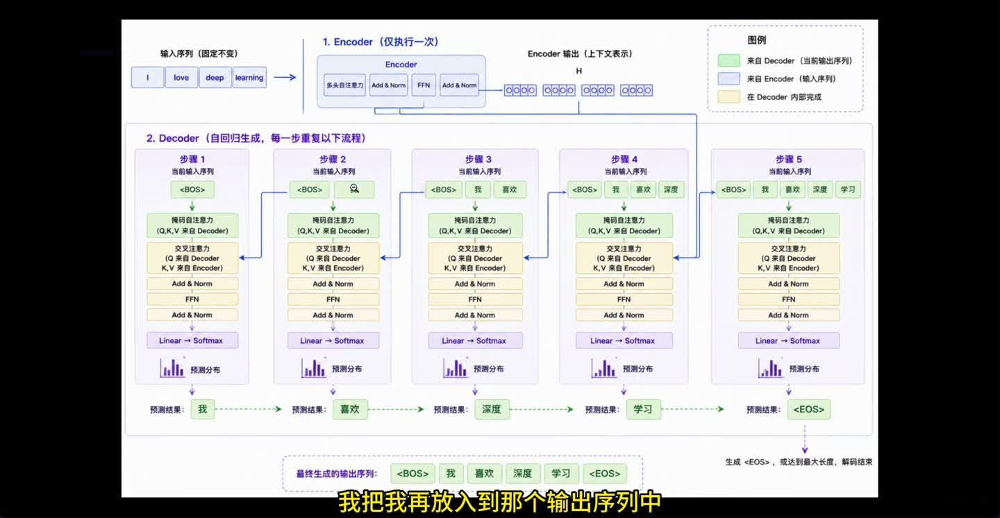
*图25：解码器拿当前目标去匹配源序列的各个位置*

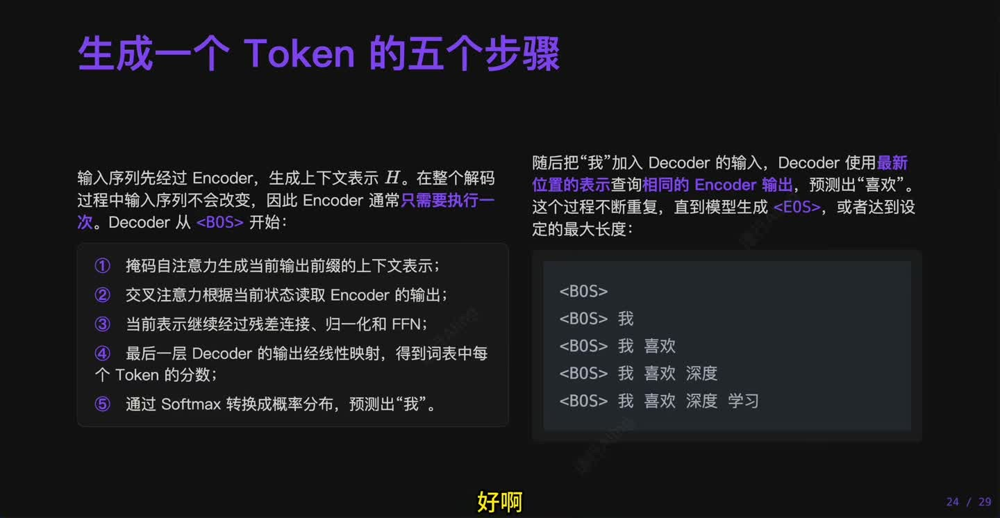
*图26：生成下一个词时，从源句对应位置取信息*

## 14. 编码一次、逐步生成输出

推理开始时 Encoder 对源序列编码一次。Decoder 从 BOS 开始，逐步运行 masked self-attention 与 cross-attention，预测并追加下一个 token，直到 EOS 或长度上限。训练时目标已知，可并行；推理时生成结果未知，需自回归逐步生成。

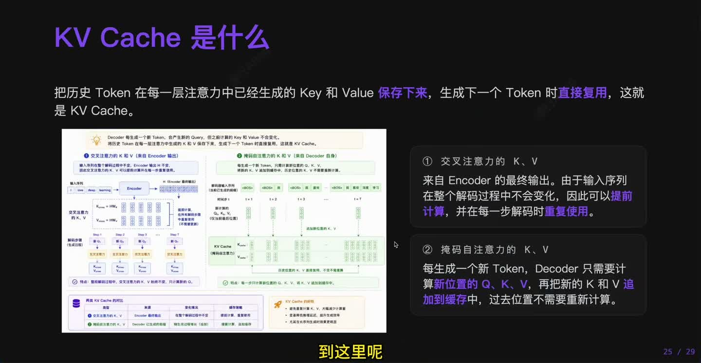
*图27：编码器先算完，解码器从起始符一个个往下写*

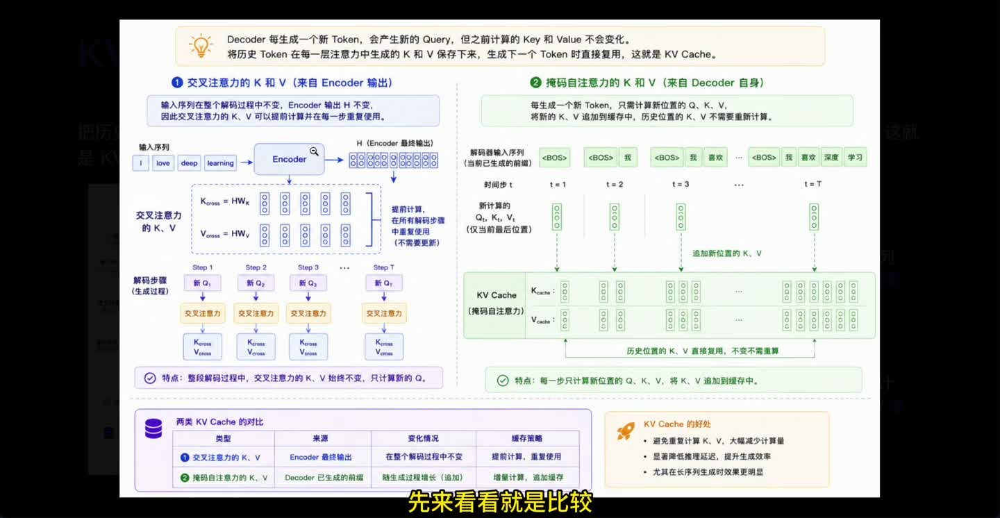
*图28：训练时目标已知，可以并行；推理要等上一个词*

## 15. 推理过程中的 KV Cache

KV Cache 保存已处理位置、各层可复用的 Key/Value。自回归解码时，旧前缀不必每生成一个 token 都重新投影；Encoder 的 K/V 对同一源输入也可在多个解码步复用。实际能缓存哪些张量取决于架构和实现。

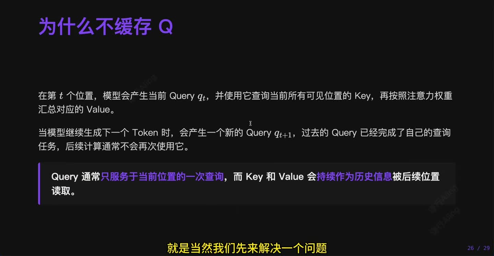
*图29：已算过的 Key、Value 留着，新词不必整段重算*

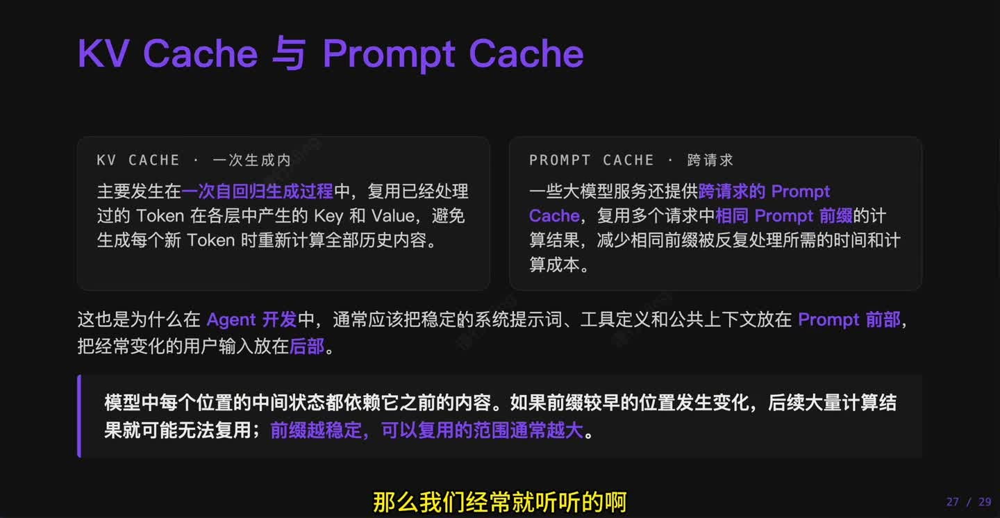
*图30：编码器的 K、V 可以在多个解码步复用*

## 16. Q 不缓存与稳定前缀

每一步会产生新的 Query，因为新 token 对应新的当前位置查询；旧 Query 已完成该位置的注意力读取，通常不会供下一位置复用。若提示词前缀相同，某些推理系统可缓存其前缀状态；具体复用范围与计费效果取决于服务商策略，不能仅由注意力公式推定。

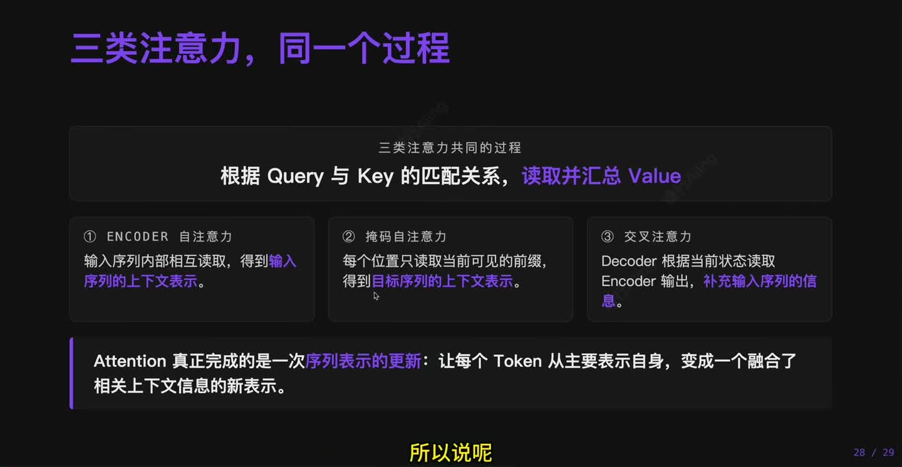
*图31：新 token 带来新的 Query，旧 Query 不给下一步用*

## 17. 总结注意力与下集预告

总结：Attention 用 Q 与 K 得到相关权重，再从 V 汇总新上下文。Transformer 三类注意力的核心计算相同，差别在 Q/K/V 来自 Encoder、Decoder 还是同一序列，以及是否施加因果 mask。下一集将专门讲多头注意力。

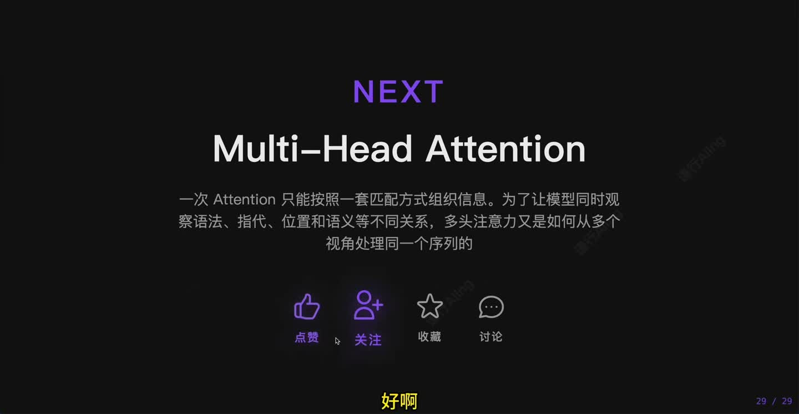
*图32：三类注意力算法相同，差别在 Q、K、V 从哪来*

---

## 延伸阅读

- [Attention Is All You Need（Vaswani et al., 2017）](https://arxiv.org/abs/1706.03762)

## 名词速查

- **Q / Query**：当前查询位置的投影表示。
- **K / Key**：供 Query 匹配的候选位置表示。
- **V / Value**：按匹配权重汇总的内容表示。
- **上下文表示**：融合相关 token 信息后的表示。
- **Self-Attention**：Q/K/V 来自同一序列的注意力。
- **Masked Self-Attention**：带因果遮罩的目标序列自注意力。
- **Cross-Attention**：Q 来自 Decoder、K/V 来自 Encoder 的注意力。
- **因果掩码**：屏蔽当前位置未来 token 的规则。
- **Multi-Head Attention**：多个投影子空间并行计算注意力后融合。
- **KV Cache**：为自回归生成复用历史位置键值表示的缓存。
- **自回归生成**：把已生成 token 接回前缀并逐步预测的过程。
